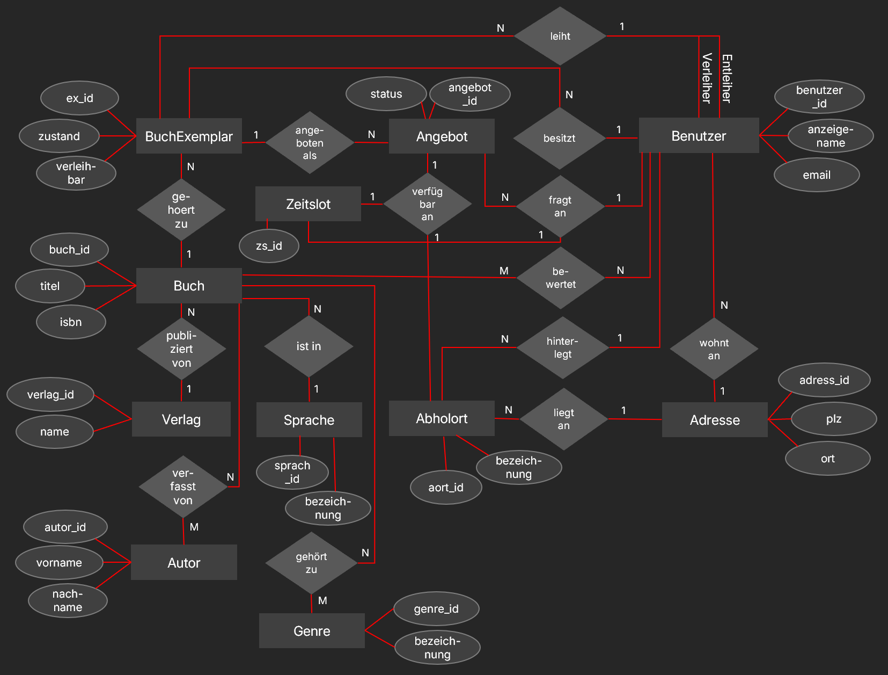
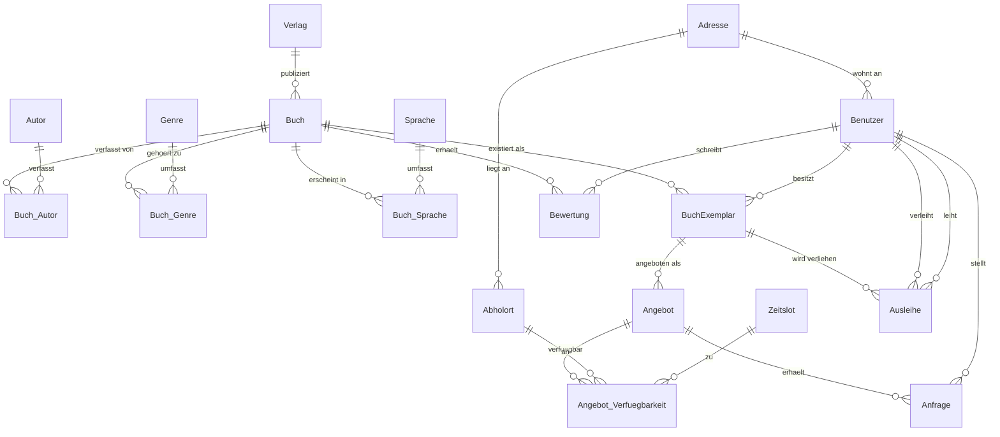

# 📚 Buchtausch-App – Relationale MySQL-Datenbank


Datenbank für eine Plattform, auf der Nutzer:innen Bücher untereinander verleihen:
vom Einstellen eines Exemplars über Anfrage, Ausleihe und Rückgabe bis zur Bewertung –
inklusive Abholorten, Zeitfenstern und Umkreissuche über Geokoordinaten.

## Highlights

- **18 Tabellen in 3. Normalform** – 5 Stammdaten-, 9 Prozessdaten- und 4 Beziehungstabellen
- **Trennung von `Buch` (bibliografische Daten) und `BuchExemplar` (physisches Objekt)** –
  ein Titel kann mehrfach im Umlauf sein, ohne dass Daten redundant gespeichert werden
- **m:n- und ternäre Beziehungen** – u. a. `Angebot_Verfuegbarkeit` verknüpft Angebot, Abholort und Zeitslot
- **Geschäftsregeln per Trigger** direkt in der Datenbank (siehe unten)
- **Datenintegrität** über Primär-/Fremdschlüssel, `UNIQUE`- und `CHECK`-Constraints
- **Umkreissuche** mit `ST_Distance_Sphere` auf Geokoordinaten
- **Analysen** mit Aggregationen und Fensterfunktionen (`RANK() OVER`, Anteile per `SUM() OVER ()`)
- **Tests**: 8 positive Testfälle, 5 Negativtests und ein vollständiger End-to-End-Anwendungsfall

## Datenmodell



*Konzeptionelles ER-Modell in Chen-Notation (eigene Darstellung, wesentliche Attribute).
Vollständige Attributliste im [Datenwörterbuch](docs/anforderungen-und-datenmodell.pdf).*

<details>
<summary>Umgesetztes relationales Schema (Tabellen und Fremdschlüssel) anzeigen</summary>



</details>

## Geschäftsregeln (Trigger)

| Trigger | Regel | Fehlermeldung |
|---|---|---|
| `trg_keine_selbstausleihe` | Niemand leiht sein eigenes Buch aus | `Selbstausleihe ist nicht erlaubt` |
| `trg_eine_aktive_ausleihe` | Ein Exemplar ist höchstens einmal gleichzeitig aktiv verliehen | `Das Buchexemplar ist bereits aktiv ausgeliehen` |
| `trg_bewertung_nach_rueckgabe` | Bewerten darf nur, wer das Buch ausgeliehen und zurückgegeben hat | `Bewertung erst nach abgeschlossener Ausleihe erlaubt` |

```sql
-- Exemplar 1 ist bereits verliehen -> wird abgelehnt
INSERT INTO Ausleihe (ex_id, verleiher_id, entleiher_id, ausleihdatum, faellig_am, status)
VALUES (1, 1, 3, '2025-06-01', '2025-06-15', 'aktiv');
-- Error Code: 1644. Das Buchexemplar ist bereits aktiv ausgeliehen
```

## Projektstruktur

| Datei | Inhalt |
|---|---|
| [`sql/01_schema.sql`](sql/01_schema.sql) | Datenbank und alle Tabellen inkl. Constraints |
| [`sql/02_indexes.sql`](sql/02_indexes.sql) | Indizes auf häufig verknüpften Spalten |
| [`sql/03_triggers.sql`](sql/03_triggers.sql) | Geschäftsregeln als Trigger |
| [`sql/04_seed_data.sql`](sql/04_seed_data.sql) | Fiktive Beispieldaten (≥ 10 Datensätze pro Tabelle) |
| [`sql/05_test_queries.sql`](sql/05_test_queries.sql) | Positive Testfälle (Joins, Beziehungen) |
| [`sql/06_negative_tests.sql`](sql/06_negative_tests.sql) | Negativtests – jede Anweisung muss fehlschlagen |
| [`sql/07_use_case.sql`](sql/07_use_case.sql) | End-to-End-Ablauf: Angebot → Anfrage → Ausleihe → Rückgabe → Bewertung |
| [`sql/08_analytics.sql`](sql/08_analytics.sql) | Auswertungen, Umkreissuche, View |
| [`docs/`](docs) | ER-Modell und Anforderungsdokument |

## Schnellstart

**Voraussetzung:** MySQL **8.0.16 oder neuer** (ab dieser Version werden `CHECK`-Constraints geprüft),
z. B. mit MySQL Workbench.

**MySQL Workbench:** Die Dateien `01` bis `04` nacheinander öffnen und jeweils komplett ausführen (⚡).
Danach `05`, `07` und `08` ausführen. Die Anweisungen in `06` einzeln ausführen (Strg+Enter),
da jede absichtlich einen Fehler auslöst.

**Kommandozeile:**

```bash
mysql -u root -p
```
```sql
SOURCE sql/01_schema.sql;
SOURCE sql/02_indexes.sql;
SOURCE sql/03_triggers.sql;
SOURCE sql/04_seed_data.sql;
SOURCE sql/07_use_case.sql;
SOURCE sql/08_analytics.sql;
```

## Ideen zur Weiterentwicklung

- Angebotsstatus per `AFTER UPDATE`-Trigger automatisch mit dem Ausleihstatus synchronisieren
- Statuswerte in Lookup-Tabellen auslagern statt als Text mit `CHECK` zu prüfen
- Höchstens eine Bewertung pro Person und Buch (`UNIQUE (buch_id, benutzer_id)`)
- Automatisierte Tests per GitHub Actions mit MySQL-Container

## Hintergrund

Entstanden im Modul *Data-Mart-Erstellung in SQL* (Informatik B.Sc., IU Internationale Hochschule, 2026).
Nach der Abgabe überarbeitet: Fehler im Bewertungs-Trigger behoben, Testdaten an die Geschäftsregeln
angepasst, Anwendungsfall robuster gestaltet (Variablen statt fester IDs) sowie Negativtests und
Analyse-Abfragen ergänzt.
